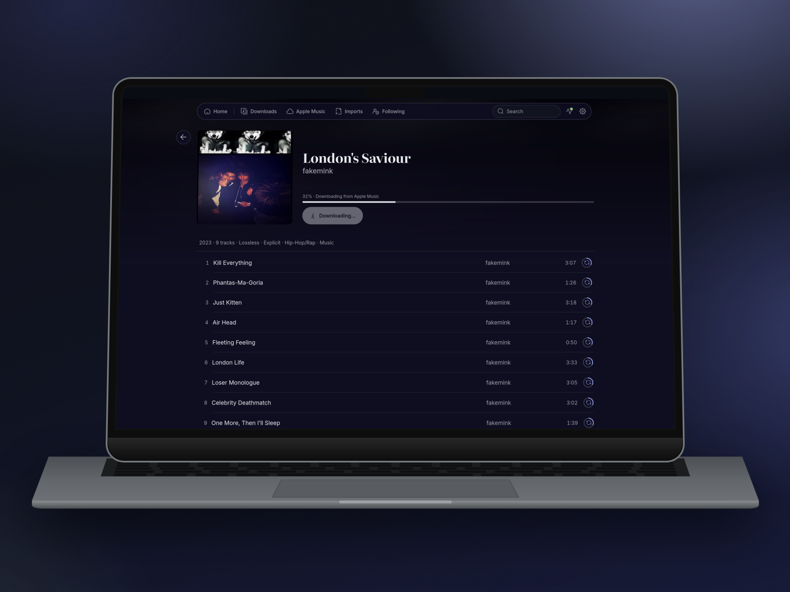
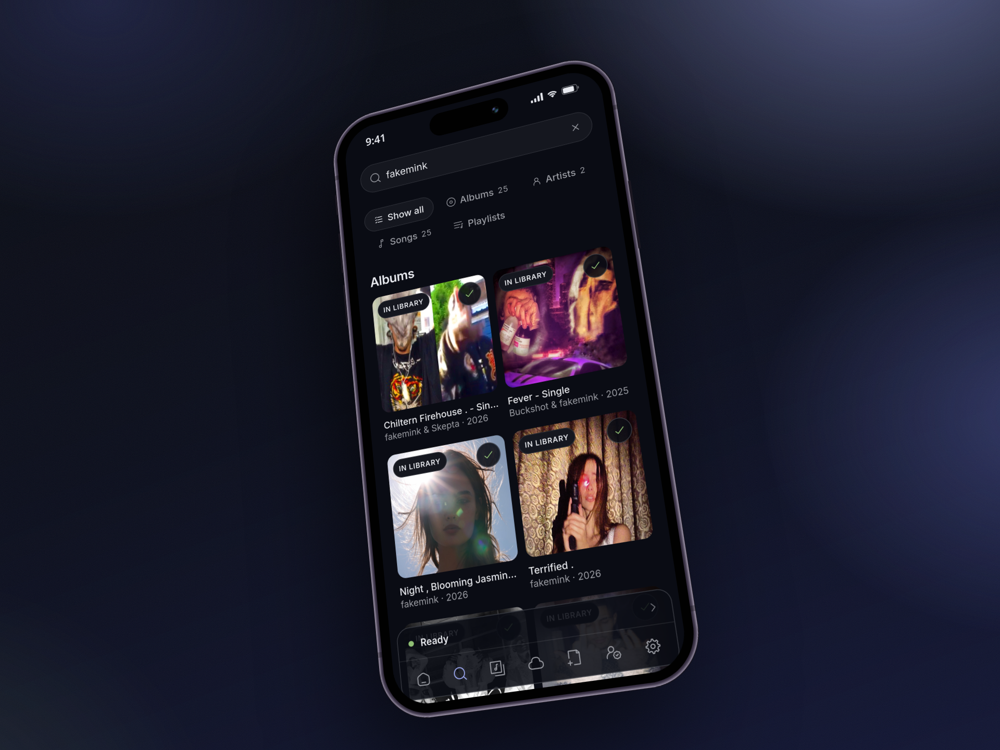
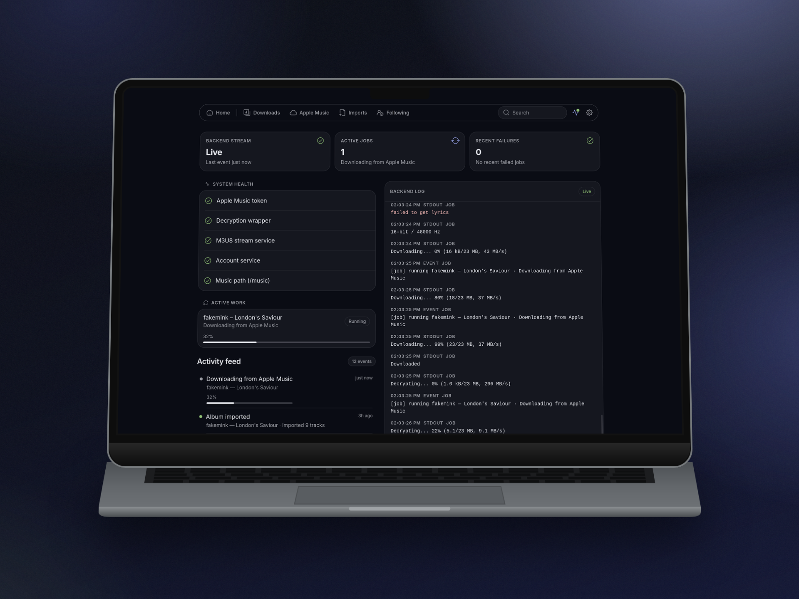

# alacarte

Self-hosted Apple Music downloader with a web UI.

  

## What it is

alacarte is a browser-based tool that downloads lossless audio from Apple Music, converts it to FLAC, and organizes it into a clean library structure you can point any media server at.

- **Search & discover:** the whole Apple Music catalog (albums, artists, songs, playlists), plus your own Apple Music library.
- **Lossless & hi-res:** ALAC streams converted to FLAC with embedded artwork and metadata.
- **Artist credits:** one ARTISTS / ALBUMARTISTS tag per artist and one COMPOSER tag per composer, so Navidrome links each real artist instead of a combined "A & B".
- **Lyrics:** embedded lyrics and sidecar `.lrc` files (needs a `media-user-token`).
- **Queuing:** single tracks, whole albums, playlists, or a bulk pick of an artist's discography (LPs / EPs / Singles).
- **Library awareness:** what's already in your library is marked, so nothing is downloaded twice.
- **Explicit / clean:** Apple lists both as separate albums; pick one in Settings, or show both.
- **Following:** follow an artist to download new releases as they drop, or a playlist to download what's added to it. The check runs on a schedule that scales with how many you follow, to stay under Apple's limits.

Settings → Library maintenance fixes artist credits, lyrics and tags for tracks that are already in your library.

Output lands in `/music/<Artist>/<Album>/01. Track.flac` (or `/music/<Artist>/Singles/` for individual songs). Playlist downloads are merged into the same artist/album library structure and also emit `/music/Playlists/<Playlist>.m3u8` with relative paths so Jellyfin/Navidrome can import playlist order.

---

## Beautiful and functional. Not just on the desktop.

<table style="border: none;">
  <tr>
    <td width="50%" align="center">
      
       
      <b>Fully responsive design</b> 
      Search, queue and manage your library from your phone.
    </td>
    <td width="50%" align="center">
      
       
      <b>Complete system visibility</b> 
      Live job tracking, health checks and the backend's log as it happens.
    </td>
  </tr>
</table>

---

## Disclaimer
**This tool is for personal archival use only.** Downloading music you do not have a valid subscription/license for violates Apple's Terms of Service. You are responsible for ensuring your use complies with applicable terms and laws in your jurisdiction.

---

## Requirements

- **`linux/amd64` (x86_64)** — the FairPlay wrapper binary and the upstream downloader image are amd64-only. On Apple Silicon Macs, Docker Desktop transparently emulates amd64 via Rosetta. On native arm64 Linux (Raspberry Pi, ARM cloud VPS), enable `qemu-user-static` / `binfmt_misc` to run amd64 containers, or use an x86_64 host.
- Docker + Docker Compose
- An **Apple Music paid subscription**

## Quick start

1. `git clone` this repo and `cd` into it
2. Copy `.env.example` to `.env` and set `MUSIC_PATH` to your music library folder
3. Run `docker compose up -d --build`
4. Open `http://<your-host>:7373`
5. Grab the one-time setup token from the logs (`docker compose logs web`) and use it on the welcome screen with your new username and password
6. In Settings, enter your Apple ID email and password (the storefront is detected from your account)

## Upgrading

Pull and rebuild with `docker compose up -d --build`. Settings and the saved Apple credentials carry over; an install without a password yet asks for the setup token from the logs once.

## Security

alacarte ships with a built-in password gate: the first visit asks for a username, a password and the one-time setup token from the logs, and every page and API endpoint is locked behind it.

- **Don't expose this directly to the public internet.** Several cloud providers ship hosts with permissive default firewalls. Verify your firewall, and put a reverse proxy / VPN / mesh network in front of the UI before opening it up to anything beyond your LAN.
- **No Docker socket is mounted.** First-time Apple login goes through a small supervisor inside the wrapper container (port 40020, internal network only), so the web container has no control over the host's container engine. Its sign-in endpoints need a token the supervisor creates in `data/supervisor/token` on first start, so other containers on a shared `DOCKER_NETWORK` can't drive the Apple sign-in.
- **Tighten the bind to localhost only:** set `WEB_BIND=127.0.0.1` in `.env` if you front the app with a reverse proxy on the same machine and don't want the UI reachable on your LAN.
- **Already running your own auth?** Set `AUTH_DISABLED=true` in `.env` to skip the built-in password gate (e.g. when fronting with Authelia, Cloudflare Access, Tailscale, etc).
- **Rate limiting and lockouts are built in** for setup/login/password-change routes (429 + Retry-After + temporary lockouts).
- **Sessions support revoke-all** from Settings → Account ("Sign out on all devices").
- **Password hashing uses memory-hard scrypt** (`N=131072, r=8, p=1`).
- **Trust proxy and secure cookies:** set `TRUST_PROXY` correctly when running behind a reverse proxy so HTTPS detection and cookie security are accurate.
- **Change or reset:** the password lives at `data/web/auth.json`. Change it from Settings → Account, or reset by deleting that file and restarting the container — the next visit will prompt for a new one.

## First login flow

alacarte needs to authenticate with Apple to obtain decryption tokens. This happens once, then the session persists across container restarts.

1. Enter your credentials in Settings and click Save.
2. If Apple requires 2FA, you'll see a prompt asking for the 6-digit code. If a trusted device only shows Allow / Not Me, generate a code from Settings → Apple ID → Sign-In & Security → Get Verification Code.
3. Enter the code within ~2 minutes.
4. When you see "Ready", you're good to search and download.

### Sign-in troubleshooting

If Apple sign-in fails, check these first:

1. Confirm the Apple ID has an active Apple Music subscription on `music.apple.com`.
2. Confirm the Apple ID has signed into Apple Music at least once on a real Apple device or on the web app.
3. Confirm DNS, firewall, VPN, and proxy rules allow the host to reach Apple's services.
4. Confirm the storefront in Settings matches the Apple ID's region.
5. Confirm you're running the latest image/build (newer builds include login parser fixes and richer wrapper diagnostics).

Wrapper response type 4 is a generic StoreServices failure, not a wrong password. Read the server message and StoreServices error in the failure log before retrying, as repeated attempts can lock the Apple account. A very large negative StoreServices error comes from an older wrapper build: rebuild it with `docker compose build --no-cache wrapper`.

## How downloads behave

- Jobs run **one at a time** — queuing many items won't speed things up, it just lines them up.
- Download speed is throttled by Apple and varies by time of day.
- After a download, each track is converted from ALAC to FLAC (unless you turn that off in Settings) and moved into your library.
- The queue survives page refreshes and container restarts; a download that was running when the container stopped starts again from the beginning.
- If a job fails (network hiccup, decryption glitch), you can re-queue it manually.

## Language support

- **Language** (Settings → Catalog) sets the language of the UI: English, Chinese (Simplified or Traditional), Japanese, Korean, Spanish or French. "Follow system default" uses your browser's language and falls back to English.
- **Naming language** (Settings → Library output) decides which language song, album and artist names are saved in:
  - **Display** (default): the names shown in your catalog language, exactly as before.
  - **Original if accepted**: the original-language name when its language is in your accepted list, e.g. `泡沫` instead of `Bubbles`.
  - **Dual**: both, e.g. `Bubbles (泡沫)`.

  When an original name differs, FLAC files also get `ORIGINAL_TITLE`, `ORIGINAL_ALBUM` and `ORIGINAL_ARTIST` tags.

The "original" name is what Apple shows in your storefront's own language, so the naming modes only change anything when that differs from your catalog language (for example a Japanese storefront with English as the catalog language). Original-if-accepted recognises Chinese, Japanese and Korean names. A naming mode adds one cached Apple request per album, and playlist and "fill missing tracks" downloads keep display names.

## Notes and limits

**IP rate-limiting** Apple rate-limits by IP when you pull a lot at once. It isn't a permanent ban: I was soft-blocked for about a day after ~1500 songs. alacarte paces its own requests (Settings → Apple Music API); for very large archives, spread jobs over a few days or run behind a VPN.

**Storage** - Lossless albums are ~300–600 MB each.
- By default, temporary staging is written to `/tmp/alacarte-staging` while jobs run.
- You can switch staging location in Settings → Library output.
- Stale job staging folders older than 24 hours are pruned on app boot and every 6 hours afterwards.
- If your host's `/tmp` is tmpfs (RAM-backed), large downloads can exhaust memory. Either bind-mount a disk path to `/tmp/alacarte-staging` in your compose override, or toggle "Store temp staging inside music library" on.
- If you intentionally point staging inside your music library, configure your scanner to ignore hidden directories.

**Sharing a network with Jellyfin/Plex/etc.** By default alacarte creates its own `alacarte-net` Docker network. If you'd rather attach to an existing network (e.g. the one your media server already uses), set `DOCKER_NETWORK=<name>` and `DOCKER_NETWORK_EXTERNAL=true` in `.env`.

**Local compose tweaks** If you need to change things the `.env` variables don't cover (extra volumes, additional environment, etc.), drop a `docker-compose.override.yml` next to the main compose file. Docker Compose auto-merges it and it's gitignored, so you can run `docker compose up` normally without polluting the committed config.

**Navidrome** With your Navidrome login in Settings → Integrations, alacarte asks Navidrome for a quick scan the moment a download finishes.

**Apple Music in Subsonic clients (octo-fiesta)** [filipton's octo-fiesta](https://github.com/filipton/octo-fiesta) is a Subsonic proxy for Navidrome that adds streaming catalogues to your music apps' search and downloads what you play. It can use alacarte for Apple Music: turn it on in **Settings → Integrations**, then give octo-fiesta the `AppleMusic__AlacarteUrl` and `AppleMusic__ApiToken` shown there. Both must mount the same music folder. The token only opens `/api/integration/v1`, and the integration stays off until you turn it on.

## Troubleshooting

| Problem | Likely cause | Fix |
|---------|--------------|-----|
| "Sign in required" health warning | Wrapper isn't authenticated | Go to Settings and complete the login flow |
| "Wrapper supervisor not reachable" | Wrapper container down or still starting | Verify the wrapper container is healthy via `docker compose ps` and `docker compose logs wrapper` |
| Downloads stuck at 0% | Apple token expired or wrapper down | Wait a moment; it will auto-retry. If still stuck, restart the stack |
| Tracks show "failed" | Temporary Apple/server hiccup | Re-queue the album; transient failures usually clear |
| FLAC files are truncated | MP4Box runtime issue | Rebuild the container image and redeploy |

## Architecture

alacarte runs on a shared Docker network with three primary components:
- **web:** This repository. It wraps the downloader CLI as a child process and serves the React SPA on port `7373`.
- **amdp:** The underlying downloader binary, included at build time.
- **wrapper:** A FairPlay decryption daemon that handles the DRM removal, included at build time.

## Credits

Built upon:
- [zhaarey/apple-music-downloader](https://github.com/zhaarey/apple-music-downloader)
- [WorldObservationLog/wrapper](https://github.com/WorldObservationLog/wrapper)

## License

AGPL-3.0 — see LICENSE

This tool interacts with Apple Music services. You are responsible for ensuring your use complies with Apple's Terms of Service and applicable laws in your jurisdiction.
